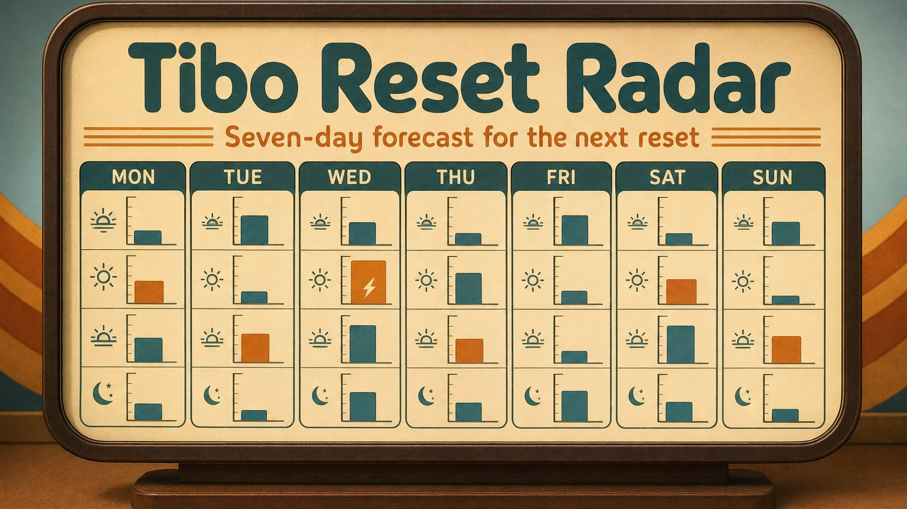
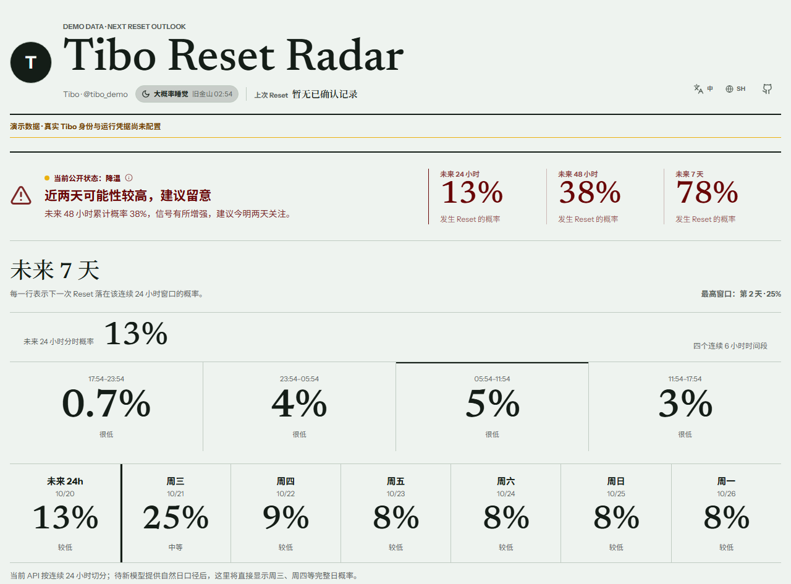
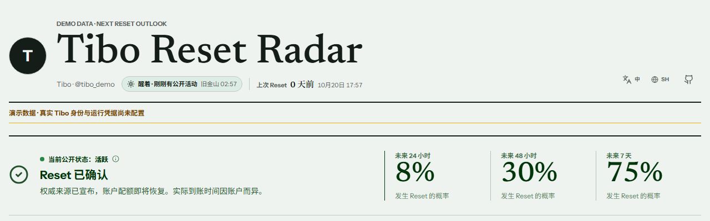
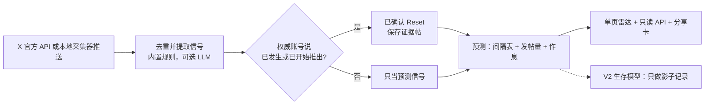

# Tibo Reset Radar

给 Codex 用户：按 Tibo 的 X 公开动态，估算额度 24 小时、48 小时、7 天内 Reset 的概率。

<p align="center">
  
</p>

## 🔍 实际效果



上图是本仓库在本地 Docker 里跑出来的页面（2026-10-20）。**数据是演示数据**：追踪账号是 `tibo_demo`，帖子是仓库自带的 3 条示例，不是真实 Tibo 的帖子。

- **Tibo**：X 账号 [@thsottiaux](https://x.com/thsottiaux)，会在 X 上公开宣布 Reset（见 [`config/target.live.example.json`](./config/target.live.example.json)）。
- **Reset**：Codex 与 ChatGPT Work 付费用户用量额度的一次公开重置。只有 @thsottiaux、@OpenAI、@OpenAIDevs、@embirico 发帖说「已发生」或「已开始推出」才算已确认；对未来 Reset 的承诺只当预测信号。

## 📌 状态与限制

- **状态**：实验项目；最近一次提交 2026-08-17，最新 tag 是 v0.4.4，没有 GitHub Release。〔待核：是否仍在维护〕
- **适用范围**：只追踪一个 X 账号、一类事件。概率是按历史间隔、近期发帖量和作息算的启发式估算，没有经过校准，最高 99%，不是承诺。
- **默认是演示模式**：页面顶部会标「演示数据」。接入真实数据要自己提供 X API 的 Bearer Token，或用本地采集器推送，见 [接入真实数据](./docs/going-live.md)。
- **依赖与平台**：Docker 和 Docker Compose；本地开发另需 Node.js 24、pnpm 10.4。CI 在 Ubuntu 上跑；2026-10-20 在 Windows 11 + Docker Desktop 上实测通过，macOS 未测。
- **数据去向**：状态存在本机一个 SQLite 文件里。真实模式只调用 X 官方 API，可选接 OpenAI 兼容的 LLM 接口提取信号（不配就用内置规则）。没有登录、支付、订阅、邮件和 webhook。

## 📦 快速开始

三条命令，首次构建要拉取 Node 镜像并安装依赖：

```bash
git clone https://github.com/RZX00/tibo-reset-radar.git && cd tibo-reset-radar
cp .env.example .env
docker compose up -d --build
```

打开 <http://127.0.0.1:4173>。端口被占用或被系统保留时，改 `docker-compose.yml` 里的 `127.0.0.1:4173:8787`。停止并清理：`docker compose down -v`。

一个容器包办一切：启动时迁移数据库，从同一个地址提供 API 和页面，并在进程内跑采集循环。

## 🚀 第一次使用

打开页面后，在终端查看当前状态：

```bash
curl -s http://127.0.0.1:4173/api/reset-status
```

```json
{"state":"forecasting","event":null}
```

再看预测（数值随时间变化，下面是节选）：

```bash
curl -s http://127.0.0.1:4173/api/forecast
```

```text
{"schemaVersion":"1.0", ... ,"model":{"version":"cadence-activity-circadian-v1","validationStatus":"heuristic",...},
 ... ,"cumulative":{"within24h":0.13,"within48h":0.3825,"within72h":0.4680000000000001,"within168h":0.776},"days":[ ... ]}
```

### 同一个页面，两种帖子，两种结果

下表是在本地 Docker 里实际跑出来的。第一行是演示模式自带的帖子；第二行用推送收件箱投喂了一条演示帖，复现步骤见 [`docs/try-confirmation.md`](./docs/try-confirmation.md)。

| 演示账号发的帖子 | `/api/reset-status` 返回 | 页面 |
|---|---|---|
| `The next usage reset is planned for tomorrow if the rollout stays healthy.`（承诺未来） | `{"state":"forecasting","event":null}` | 仍显示概率，没有「已确认」 |
| `Usage limits have been reset for all paid users. The reset is complete.`（宣布已发生） | `{"state":"confirmed_reset","event":{"eventId":"reset-2001", ... ,"scope":"all","evidencePostIds":["2001"]}}` | 显示「Reset 已确认」，24 小时概率回落到冷却期基线 8% |



## 🆚 和自己盯着时间线比，差在哪

| | 自己盯 Tibo 的时间线 | 本雷达 |
|---|---|---|
| 「快了」的依据 | 印象 | 距上次已确认 Reset 的时间（固定间隔表，仓库文档记录的历史平均间隔约 3.6 天）；近 24 小时发帖和回复数相对前 14 天的变化；Tibo 的常规作息 |
| 什么算「已重置」 | 自己读帖子判断 | 只认配置里的权威账号（真实配置为上述 4 个）的「已发生 / 已开始推出」；承诺、有限范围的 Reset、撤回各自单独处理 |
| 会不会说「100%」 | 没有统一标准 | 不会，上限 99%；「已确认」是另一个状态，必须有证据帖 |
| 依据看得见吗 | 不可见 | 每个时间窗附原因码；页面可展开近 24 小时的原始帖子 |

## 🛠️ 能力与工作原理



- **预测**：28 个连续 6 小时窗口，页面汇总成未来 24 小时分段和未来 7 天。当前公开模型 `cadence-activity-circadian-v1` 由三部分组成：按距上次 Reset 的时间查的间隔表、按近期发帖量做的修正、按旧金山时间作息做的修正。
- **公开状态**：活跃、降温、安静、数据延迟。数据新鲜、状态为「安静」且近 30 天至少有 20 条非转发帖时，页面会把最安静的连续 8 小时（UTC）标成「可能在睡觉」，这只是展示，不改概率。
- **页面**：中文和英文，按浏览器语言选择，右上角可切换并记住；所有文案在 [`apps/web/src/i18n.ts`](./apps/web/src/i18n.ts)。
- **只读 API**：`/api/status`、`/api/forecast`、`/api/events`、`/api/reset-status`，以及 1200×630 的分享卡 `/api/share-card.png`。
- **采集方式**：服务自己轮询 X 官方 API；或设 `RADAR_COLLECTOR_MODE=inbox`，由你电脑上的采集器推送，X 会话不必放到服务器上。
- **修复漏判**：策略更新后，`pnpm signal:reprocess -- <帖子 ID>` 对一条已入库的帖子重新判定。

### 更多文档

| 文档 | 内容 |
|---|---|
| [`docs/going-live.md`](./docs/going-live.md) | 从演示切到真实数据：目标账号、环境变量、本地采集器 |
| [`docs/try-confirmation.md`](./docs/try-confirmation.md) | 本地复现「Reset 已确认」 |
| [`docs/forecast-v2-shadow.md`](./docs/forecast-v2-shadow.md) | V2 影子策略：特征、结果定义、成熟度（英文） |
| [`docs/operations.md`](./docs/operations.md) | 发布、回滚、重新判定、数据保留（英文） |
| [`docs/2026-08-03-architecture-model-and-operations.zh.html`](./docs/2026-08-03-architecture-model-and-operations.zh.html) | 架构、模型说明、数据政策、验证记录（下载后用浏览器打开） |

## 🧪 开发与验证

```bash
pnpm install --frozen-lockfile
pnpm check             # lint、构建、类型检查、单元测试、开源面扫描
pnpm test:integration  # 真实 SQLite 上的端到端：采集、编辑和删除、提取、确认、V1 与 V2 预测、API
pnpm model:backtest    # V1 回测，需等满 168 小时窗口
```

不用 Docker 开发：先 `pnpm db:migrate`，再分别跑 `pnpm dev:api` 和 `pnpm dev:web`。

## 🚧 边界

- 只用 X 官方 API 和可选的官方状态页、发布页，不抓取网页，不做浏览器自动化。
- 没有登录、支付、订阅、邮件、付费 API Key 和 webhook。
- 不依赖 ewo 的主仓库、数据库、运行时和凭据。
- Git 里没有真实的 X 历史和密钥。

## 📄 许可证

Apache-2.0，见 [`LICENSE`](./LICENSE)。ewo 的开源实验项目。
